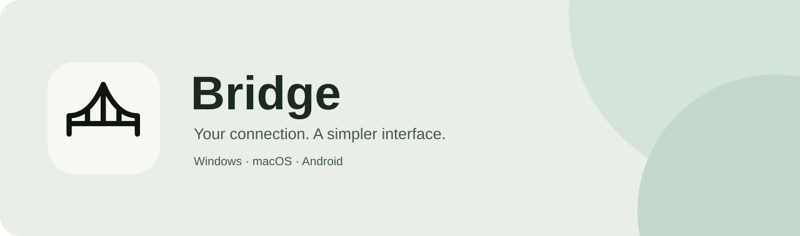

<p align="center"></p>

<p align="center">
<a href="../../releases"></a>
<a href="#getting-started"></a>
<a href="../../issues"></a>
</p>

A compact subscription client built with Python and Xray. Material You-inspired colors, a focused connection screen, and session statistics.

## Features

- Import HTTPS subscriptions containing plain-text or Base64 VLESS and Trojan links.
- TCP, WebSocket and gRPC transports, with TLS and VLESS REALITY support.
- Six color palettes, a clipboard button, connection timer and traffic counter.
- System HTTP/HTTPS proxy integration on macOS.
- Android VPN service with a dark interface and system-bar insets.
- Windowed Windows executable with an embedded Python runtime and Xray core.

## Downloads

Open **[Releases](../../releases)** and select the package for your device.

| Package | Target | How to run |
| --- | --- | --- |
| `Bridge-macOS-Intel.zip` | Intel macOS | Extract and open the complete `Bridge.app` bundle. |
| `Bridge.exe` | Windows x64 | Run the executable. Microsoft Edge WebView2 Runtime is required. |
| `Bridge.apk` | Android 8+, ARM64 | Install the APK and approve the Android VPN permission. |

Python and Xray are bundled. The application creates settings and temporary files on the device. The Windows package extracts its runtime to a temporary directory at startup.

The current Android APK is signed with a development key. Desktop packages are not commercially code-signed or Apple-notarized. Windows runtime behavior and Android VPN connectivity still need physical-device validation.

## Getting started

1. Copy your subscription URL.
2. Open Bridge and press **Вставить** (Paste), then **Загрузить** (Load).
3. Select a server and press **Подключить** (Connect).
4. Approve the operating-system permission when prompted.

The interface currently uses Russian labels. On Windows, configure the application you want to route through the HTTP proxy `127.0.0.1:10809`. Remove that setting when you disconnect. macOS configures its system proxy automatically. Applications that ignore system proxy settings may use a direct connection.

The timer and traffic total cover the current session. Traffic is the sum of uploaded and downloaded bytes measured by Xray. Disconnecting preserves the last displayed totals until the next connection.

## Appearance and storage

Open **Настройки** (Settings) to choose Sage, Ocean, Lilac, Clay, Rose or Sand. Desktop appearance follows the system light/dark preference. Android uses a dark theme.

Palette preferences are stored in the application's user-data directory. Subscription URLs and server lists stay in process memory. Clipboard access occurs when the Paste button is pressed.

## Build from source

### Windows and macOS

Use Python 3.12. macOS also requires Xcode Command Line Tools.

```sh
python -m venv .venv
# Activate .venv using the command for your shell.
python -m pip install -r requirements.txt
python build.py
```

Run the commands on the target operating system. The build downloads the matching Xray release and verifies its SHA-256 checksum. Output is written to `dist/`. macOS builds follow the architecture of the Python interpreter.

To regenerate icons, install Pillow and run `python make_icons.py`.

### Android

Install JDK 17, Android SDK 35 with Build Tools 35.0.0, Gradle 8.10.2 and Python 3.12. Set `JAVA_HOME` and `ANDROID_HOME`.

```sh
python -m pip install certifi
python prepare_android.py
gradle -p android assembleDebug
```

The APK is written to `android/app/build/outputs/apk/debug/app-debug.apk`. The preparation script downloads the pinned ARM64 Xray executable and copies shared Python sources. Preserve your signing key to ship compatible updates. Increase `versionCode` for each Android release.

## Project layout

| Path | Purpose |
| --- | --- |
| `app.py`, `controller.py` | Desktop entry point and shared application state |
| `bridge.py`, `connection.py` | Subscription parsing, Xray lifecycle and statistics |
| `mac_proxy.m` | macOS system-proxy helper |
| `assets/bridge.html` | Shared interface |
| `android/` | Android activity, VPN service and Python integration |
| `build.py`, `prepare_android.py` | Build preparation |
| `docs/PUBLISHING.ru.md` | GitHub and release guide |

## Contributing

Report the operating system, application version, steps to reproduce and exact error message. Remove subscription URLs, credentials and server identifiers from reports and screenshots.

## Licensing and acknowledgements

Bridge's author has not selected a source-code license yet. Public source availability alone does not grant a general reuse license. Review [third-party components](docs/THIRD_PARTY.md) before redistribution. Xray, Python, pywebview, Chaquopy and other dependencies retain their own licenses.

[Russian publishing guide](docs/PUBLISHING.ru.md)
